# High-Precision Audio-Visual Stimulus Presentation with PTB: Hardware–Software–Algorithm Manual

> Beginner-friendly edition · Distilled from long-running measurements on several rigs.
> Goal: make the interval between "the computer says go" and "the participant really sees/hears it" **short, stable, and audio-visually aligned**.

---

## 0. The core idea in one paragraph

MEG resolves milliseconds. Before each stimulus we send a square wave (Trigger) to the sync acquisition circuit and treat its **rising edge** as "stimulus onset".

But in reality:

```mermaid
sequenceDiagram
    participant P as Stimulus program (PTB)
    participant T as Trigger Box / serial
    participant D as Display / sound card / earphone
    participant S as Participant (eye/ear)
    participant N as NI acquisition card
    P->>T: IOPort Write(255)
    T->>N: square-wave rising edge (t0)
    P->>D: Flip frame / Start audio
    D->>S: light/sound truly arrives (t1)
    S->>N: photodiode / microphone records t1
    Note over T,N: delay = t1 - t0; must be measured and compensated
```

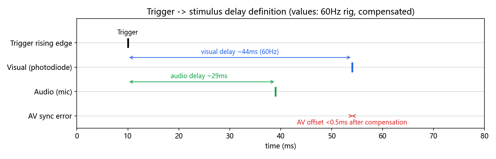

- **Delay** = physical arrival − Trigger rising edge. Tens of ms is normal.
- **Jitter** = delay wobbling trial to trial. That is the killer. Averaging needs jitter **<1 ms**; AV alignment needs **<0.5 ms**.
- Everything in this manual exists to push jitter below 1 ms while keeping absolute delay small and compensable.

Representative results (measured):

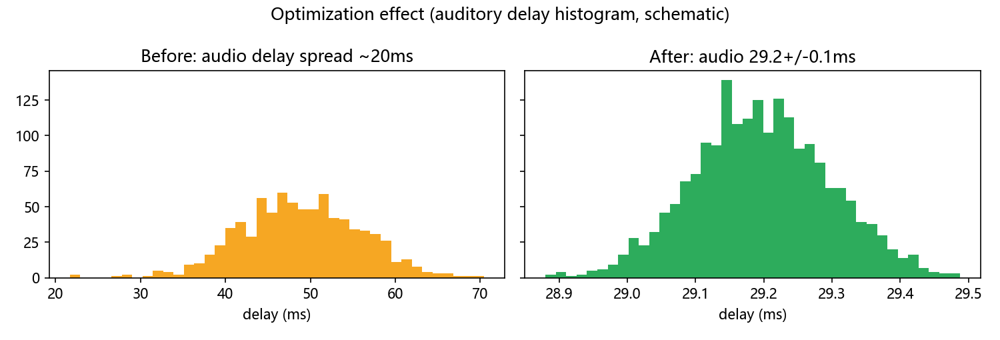

| Condition | Visual delay | Auditory delay | AV offset | Verdict |
|---|---|---|---|---|
| Starting point (Win + defaults) | 47 ms ±1 ms | 49 ms ±20 ms | — | audio unusable |
| Optimized 60 Hz (Ubuntu + AMD) | 44–69 ms ±0.1–0.4 ms | 29.2 ms ±0.1 ms | ±0.2 ms | passes, ready for experiments |
| 144 Hz high-refresh | ~19→12→8 ms ±0.2 ms | ~21 ms ±0.1 ms | ±0.1 ms | faster = smaller |
| 240 Hz (AOC panel / Optoma projector) | ~5.6 ms ±0.05 ms | — | — | full-speed B/W alternation limit |

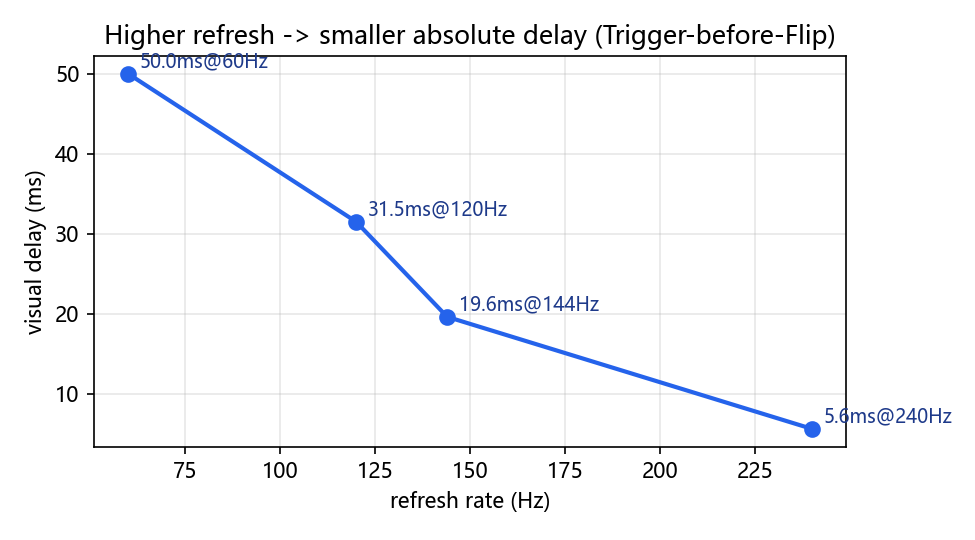

These delays are essentially one screen refresh, because the trigger is sent before the flip. Send the trigger after the flip and the delay no longer tracks the refresh rate. The reason is in §4.

---

## 1. Hardware: what to buy and how to wire it

### 1.1 Don't confuse the two systems

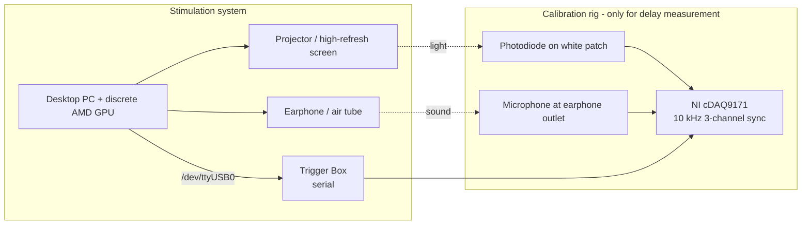

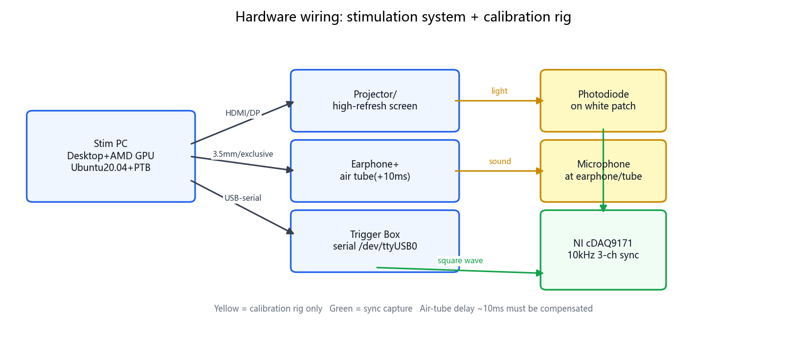

**Real photos (from `实验记录2024_11.docx`, Fig. 1)** — left: microphone fixed at the earphone / air-tube outlet to record sound; right: photodiode fixed on the white patch of the screen to record light. Both plus the Trigger square wave go into the NI cDAQ9171 (10 kHz, 3 channels in sync):

| Microphone mounting | Photodiode mounting |
|---|---|
| 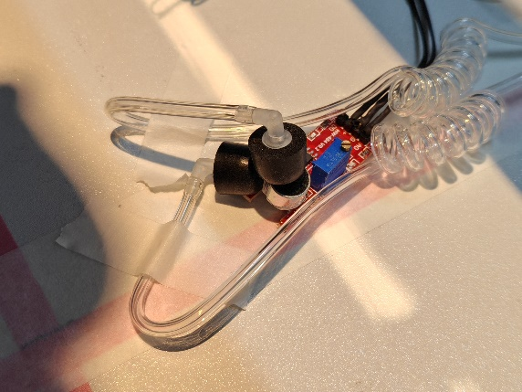 | 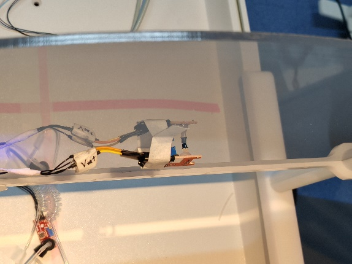 |

> Photo checklist: mic capsule faces the sound outlet (move it to the adapter-box outlet when using an air tube); photodiode face sits flush on the white patch with black tape blocking stray light; tape all cables down — one wiggle = one outlier.

- **Stimulus PC**: must be a **desktop + discrete GPU**, preferably an **older AMD card** (e.g. RX 5700 XT, released before 2020, so the stock Ubuntu driver still supports it). Reason: PTB works best with open-source drivers (amdgpu/mesa); Nvidia proprietary drivers, hybrid laptop graphics and Intel iGPUs all raise sync errors.
- **Display**: a plain 60 Hz projector works; high-refresh screens/projectors (144/240 Hz) give smaller absolute delay. Keep all screens at the same resolution, otherwise PTB sync degrades.
- **Audio**: an **air tube** into the shielded room adds ~**10 ms** acoustic delay — compensate it. The sound card must be exclusively owned by PTB (see the code in §4).
- **Trigger**: USB-to-serial to the Trigger Box. On Ubuntu it is `/dev/ttyUSB0`; add your user to the `dialout` group.
- **Calibration rig** (only connected during characterization, not every session): photodiode + microphone + NI card recording `Trigger/Sound/Light` at 10 kHz. The light sensor bandwidth is ~1.75 kHz (0.2 ms fall time) — plenty; low SNR is fixed by filtering (§5).

> Beginner traps: no laptops for real sessions; a mirrored screen image breaks up during fast black–white flicker; cheap esports panels flash at random and throw outliers. AOC panels and the ViewSonic projector were stable in these measurements; some no-name and CFORCE panels were not.

---

## 2. Software: the one worry-free combo

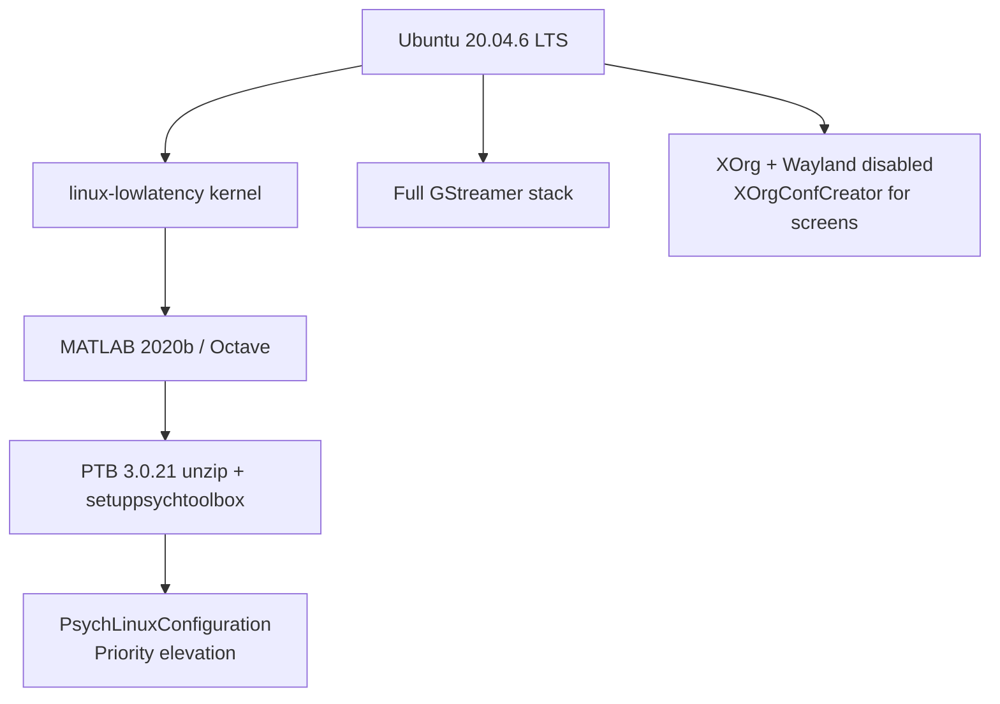

- **Pin Ubuntu 20.04**: after 22.04 the desktop moved from XOrg toward Wayland. When I last surveyed this (about two years ago) PTB had not followed that move; it may be under development now. The bugs were real either way (the well-known 24.04 "click the top-right corner to restore pageflipping" bug; 25.04 dual-screen looks fine but PTB sync can still fail). 20.04 + the stock open-source driver is the combination that stayed stable.
- **Key switches**:
  - Disable Secure Boot in BIOS; `WaylandEnable=false` in `/etc/gdm3/custom.conf`; launch with plain `matlab`, never `sudo matlab`.
  - `sudo apt install linux-lowlatency`.
  - Install the full GStreamer set per the official guide (needed for video stimuli).
  - Don't `apt`-install PTB (too slow) — download the zip, unzip to a normal folder (not inside the MATLAB toolbox), `cd` there and run `SetupPsychtoolbox`, then `PsychLinuxConfiguration`.
- **GPU driver**: with AMD just use the stock open-source driver; don't chase proprietary ones. If you insist on Nvidia, `blacklist nouveau` and install the `.run` from tty with gdm3 stopped — but expect worse sync than AMD.

---

## 3. Display configuration: Single vs Multi screens, explained once

| Mode | How | Pros | Cons |
|---|---|---|---|
| Single screen | `XOrgConfCreator` merges projector + monitor into one big screen, `Screen('OpenWindow',0)` fullscreen | best sync, exact refresh | all screens must share one resolution; drawing X must be offset by half a screen; refresh is dragged down by the slowest panel |
| Multi X-Screen | each output is its own Screen (`Screen 0/1/2`) | per-screen refresh (e.g. main 60 + stim 144) | slightly worse timing, needs `ScreenToHead` to pick the sync reference |

```matlab
% Single-screen exclusive + sync source (middle numbers are found by trial; DP3 often gives 3)
Screen('Preference','ScreenToHead',0,1,3,0);
Screen('Preference','SkipSyncTests',0);   % 0 = run the sync check; only pass counts
[window, rect] = Screen('OpenWindow', 0, black);  % fullscreen, covers every other GUI
HideCursor;  % must come AFTER OpenWindow
```

- Toolchain: with no Conf file, set resolution/refresh in the desktop Display panel → generate with `XOrgConfCreator` in MATLAB → pick with `XOrgConfSelector`. If it breaks, just delete the new Conf under `/etc/X11/xorg.conf.d/` and reboot.
- Can't see the extended screen's modes? Query per screen: `xrandr --screen 2`; set rate e.g. `xrandr --screen 2 --output HDMI-2 --mode 2560x1440 --rate 144`.
- Done = `SkipSyncTests=0` passes with no `Synchronization Failure/Trouble` and no `didn't use pageflipping`. On 24.04, if pageflip is reported, click the desktop's top-right/notification area once and rerun (a confirmed GNOME bug).

---

## 4. Core algorithm: seven PTB rules to memorize

> These are what survived thousands of measured trials. Breaking one of them can push jitter back to ±5 ms, or to ±50 ms.

1. **Desktop + discrete AMD GPU + Ubuntu + MATLAB/Octave**. No Nvidia proprietary driver, no laptop iGPU, no Windows for a real session (Windows, at its best, still wandered by about 2 ms, and SyncTest was a coin toss).
2. **Exclusive sound card, smallest buffer**: `handle=PsychPortAudio('Open',[],1,3,sf,2,1)`. The `3` is latency class 3 (lowest-latency exclusive mode). Set the buffer size to `1`; PTB raises it to the device minimum (often 14). Classes `1`, `2` and `4` were all tried. Only `3` held the jitter inside 1 ms. Class `1` split into two delay clusters 10 ms apart, which is the card's high output latency.
3. **One screen owns the GPU, and every screen uses the same resolution and refresh** (§3). Offset drawing in X by half a screen.
4. **Schedule the audio. Lock the picture to a frame.** PTB's clock is fine. It wanders only when you never tell it when to run. Audio can start as soon as the waveform is in the buffer, so pick a time that is **in the future** — far enough ahead that the buffer is already filled — and start there: `PsychPortAudio('Start', pahandle, 1, tonset+delay, 0)`. `tonset` is an anchor you chose; `delay` is the wait that makes the start reliable.

    Audio only, no picture. Two ways to place the anchor. Preferred:

    ```matlab
    PsychPortAudio('FillBuffer', pahandle, [myBeep; myBeep]);
    [nwritten, tonset] = IOPort('Write', handle, uint8(255)); % trigger, and take the anchor
    PsychPortAudio('Start', handle, 1, tonset+0.015, 0);      % 15 ms later, buffer filled, time fixed
    ```

    The other way:

    ```matlab
    PsychPortAudio('FillBuffer', pahandle, [myBeep; myBeep]);
    tonset = GetSecs;
    PsychPortAudio('Start', handle, 1, tonset+0.015, 1); % waitForStart = 1 blocks until playback
    IOPort('Write', handle, uint8(255));
    ```

    `waitForStart = 1` holds the thread until the sound actually starts, so a trigger written on the next line lands almost on the sound. Don't do this. Anything that sits on the thread makes the rest of the paradigm fragile. Use the first form.

    A picture is stricter. Think of a metronome: the image can change only on a tick, and a tick is a `Screen('Flip')`. Knowing "now" is not enough. You also need to know where the metronome is. `PredictVisualOnsetForTime` does that. Once a picture is in the trial, the audio has to use the same anchor, because the frame grid is the tighter constraint:

    ```matlab
    t1 = GetSecs;
    tonset = PredictVisualOnsetForTime(window, t1);              % when the next frame will show
    PsychPortAudio('Start', pahandle1, 1, tonset+delay, 0);
    onset = Screen('Flip', window, tonset+(n+0.5)*ifi);          % show on frame n+1
    [nwritten, when] = IOPort('Write', handle, uint8(255));
    ```

    `ifi` is one frame (16.67 ms at 60 Hz). `n` is an integer, so `n+0.5` lands in the middle of the interval and the picture appears on frame `n+1` rather than slipping to `n+2`. Once a picture is involved, write the trigger **after** the flip. That is what stops a missed frame from showing up as a wandering trigger-to-image delay.

    Audio and picture share `tonset` in this snippet, which is what makes them line up. See §6 for the offset you still have to trim.

5. **Warm up.** Run the script once before the real session so the mex files are loaded, and do not change folders afterwards.
6. **Button timing.** `KbWait` polls about every 5 ms. For a tighter reaction time, loop `KbCheck` and read `deltaSec`. Better still, record the button electrically on the same NI or MEG clock.
7. **Preload video.** At the start of each trial, `PlayMovie` to start decoding, then block in `GetMovieImage(...,1,[],2)`. Draw the first frame into the back buffer before you schedule it. Later frames use `onset+ifi*(holdFrames-0.5)`: the `0.5` sits mid-refresh so you do not straddle a boundary. See `examples/Video_Sound_Sync`. The still-image version of the same schedule is `examples/Image_Sound_Sync`.

---

## 5. Measuring and validating delay: learn to characterize your own rig

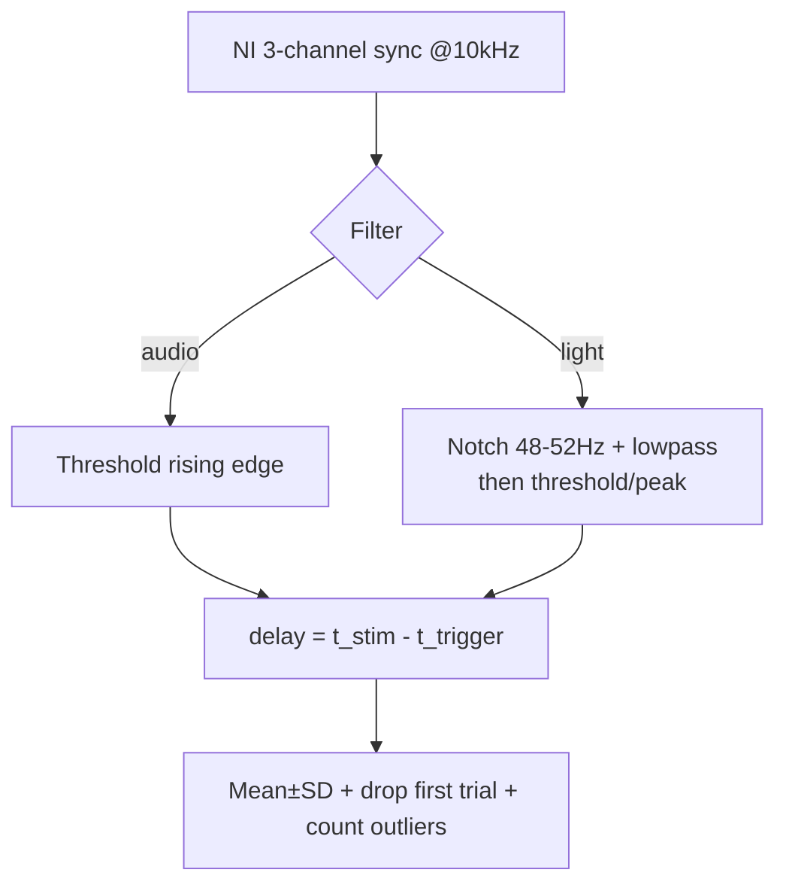

- **Record what**: `visual_N.txt` / `audio_N.txt` / `visual_audio_N.txt` with 3 columns Trigger/Sound/Light.
- **How to find the edge**: audio by direct threshold; light after a `[48,52] Hz notch + 60/70/80 Hz lowpass` (2nd-order Butterworth), then threshold/peak. Just switching the edge criterion once shrank variance from 0.49 ms to 0.2 ms — when variance is big, fix the detector before blaming PTB.
- **What to report**:
  - `Mean±SD` (e.g. `44.805±0.165 ms`), `Gaps` (Trigger intervals: `33.36±0.07 ms` @60 Hz, `13.89±0.08 ms` @144 Hz, `8.34±0.05 ms` @240 Hz).
  - Outlier fraction (e.g. `35/1309 = 2.67%`), and whether PTB's `missed deadline x/y` matches the outlier count.
  - Standard 5-step validation: ① full-speed Flip for refresh + Trigger stability → ② random ISI + timed Flip for vision → ③ random ISI + timed audio → ④ all three + button load for sync → ⑤ long run (1000–8000 trials).
- **The big first-trial wobble is normal**: the first 5–10 trials run long; declare "first trial dropped" in your statistics.

---

## 6. AV sync: aligning light and sound within 0.5 ms

The hard part: vision is frame-quantized (16.67 ms steps at 60 Hz) while audio can be scheduled freely; and an air tube makes audio **slower** than vision — the toughest case.

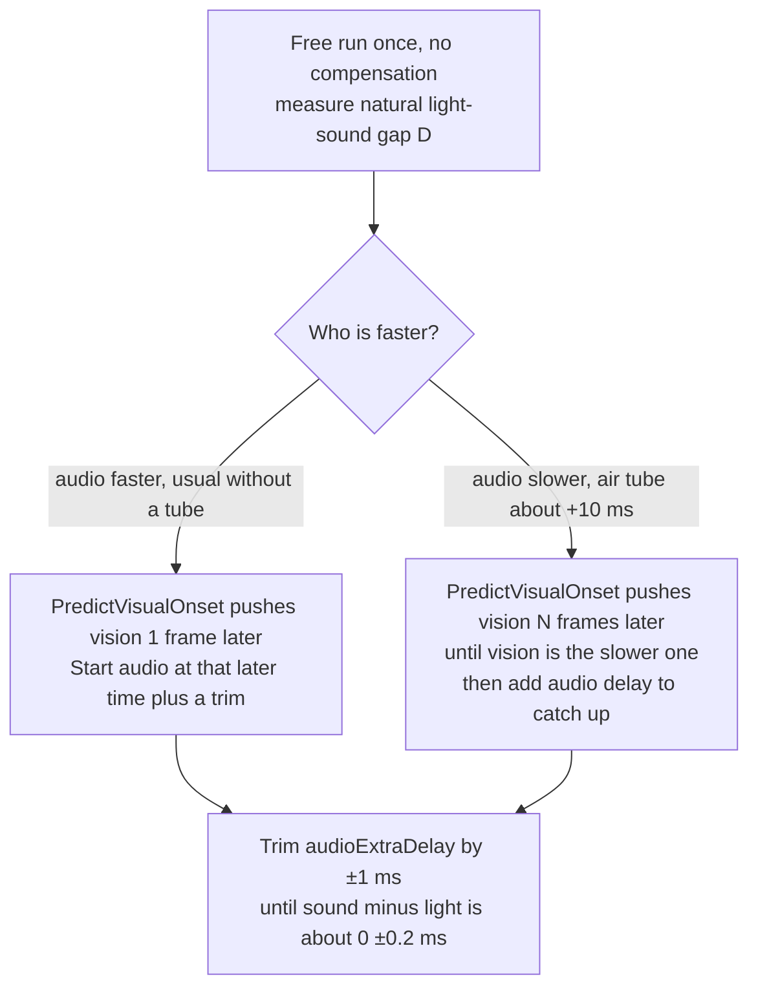

Field-tested code (high-refresh, or with an air tube):

```matlab
t1 = GetSecs;   % an anchor, not something to call at a high rate inside the loop
tonset = PredictVisualOnsetForTime(window, t1);
audioWhen = tonset + p.audioExtraDelay;
PsychPortAudio('Start', pahandle, 1, audioWhen, 0);
visualOnset = Screen('Flip', window, tonset + ifi*5.5); % 5.5 frames: vision is safely later
[nwritten, triggerWhen] = IOPort('Write', portHandle, uint8(stimN));
```

- The `0.5` in `ifi*5.5` keeps the request off a refresh boundary. Trim `audioExtraDelay` in steps of 1–2 ms until `sound − light` is about `0 ± 0.2 ms`. The tightest run in the notes was `−0.02 ± 0.08 ms`.
- If at 144 Hz you are stuck about 8 ms off (one frame) no matter what you try, the audio wait has overrun the flip window. Drop to 60 Hz, where a frame is 16.67 ms and there is room to trim. High refresh makes the absolute delay small and the sync fiddly. 60 Hz is the easier sync.
- After it looks aligned, repeat a long run. Pass means vision peak-to-peak under 1 ms, audio within ±0.1 ms, and the light–sound gap peak-to-peak under 1 ms.

One run after that trim. On a single trial the light edge and the sound edge sit on top of each other, both about 11 ms after the trigger. The sound is a tone of about 50 ms. The photodiode rises slowly, but the edge picked off it coincides with the audio onset:

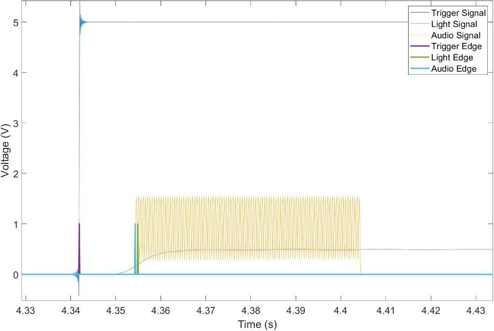

Across trials, sound minus light. Negative means the sound is slightly early. About 260 trials, each sitting on a 0.1 ms step (10 kHz sampling). The mass is between −0.6 and −0.3 ms, a few points reach −0.1 ms, and the whole range is about 0.5 ms:

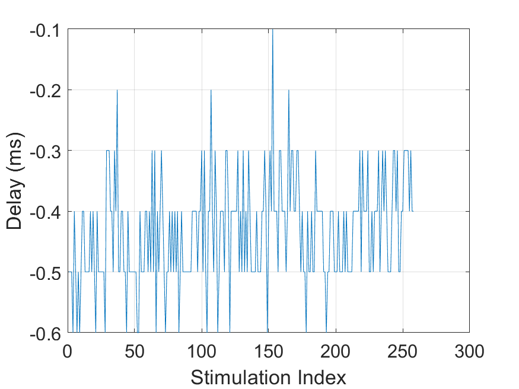

---

## 7. Troubleshooting table (check here before reinstalling anything)

| Symptom | Most likely cause | Fix |
|---|---|---|
| `Synchronization Failure / Trouble`, mass `missed deadline` | wrong GPU/driver/screen wiring; Nvidia proprietary / iGPU / laptop | switch to discrete AMD; rerun `XOrgConfCreator/Selector`; try `ScreenToHead` variants; single-screen mode; restart MATLAB; on 24.04 click the top-right notification area |
| `didn't use pageflipping` | GNOME compositor won't yield fullscreen | click top-right + notification once; try KDE; fall back to 20.04; disable Wayland |
| Two delay clusters (~10 ms apart) | `latencyclass≠3` / buffer too big / card busy | `Open(...,3,...,1)` + exclusive + buffer=1; kill other audio apps; max-out power plan |
| First trials huge, density jump mid-run | MATLAB warm-up + first-frame penalty + resolution changed without restart | warm-up run, drop first trial, restart MATLAB/PC after display changes |
| Jitter as soon as `WaitSecs` is added | thread fight with `Flip` (iron rule) | replace all waits with `Flip(when)`; keep `KbCheck`, move `GetSecs/now` out of the loop |
| Constant one-frame AV gap (16.6/6.9/8.3 ms) | Flip-before vs after Trigger convention / audio compensation out of window | unify convention; retune `audioExtraDelay`/frame count per §6; tune at 60 Hz if needed |
| Projector 127 ms ±8 ms, high-refresh won't lock | old machine + Nvidia + too-ambitious refresh | AMD-era card + 20.04; characterize projector at its native 60 Hz; use validated AOC/ViewSonic/Optoma 240 Hz for high-refresh |
| `libGL fail to open nouveau/swrast` | driver symlink lost | `ln -s /usr/lib/x86_64-linux-gnu/dri/nouveau_dri.so /usr/lib/dri/` plus the MATLAB `libstdc++.so.6` symlink |
| Serial port missing | user not in `dialout` | locate with `ls /dev/ttyUSB*` + `dmesg\|grep ttyUSB`, `usermod -aG dialout <user>`, reboot |

---

## 8. Standard operating flow: from power-on to experiment

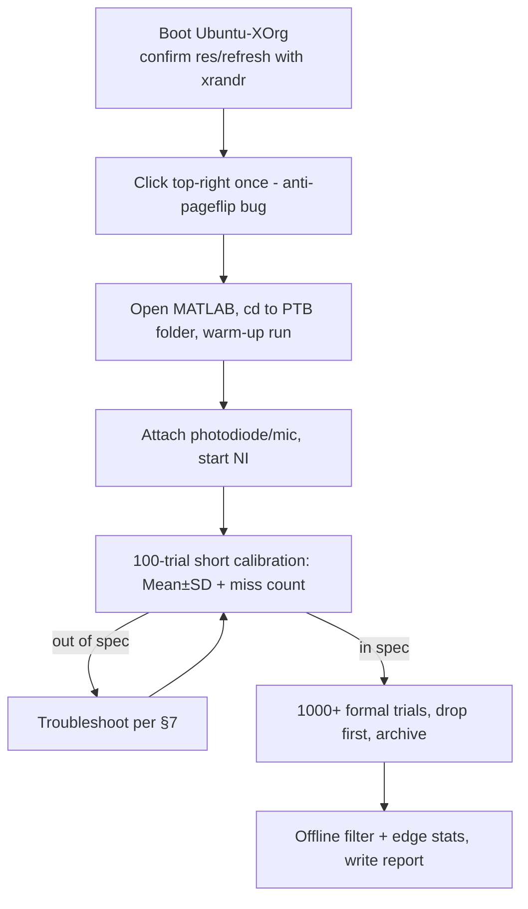

Repeat the whole flow whenever you change screens, cables, refresh rates or PCs. Name captures `visual/audio/visual_audio_<N>.txt` plus `gaps_<N>.txt` (PTB-readback `when/onset`) for traceability.

---

## Appendix A. Parameter cheat card

- Audio: `PsychPortAudio('Open',[],1,3,sf,2,1)`, `FillBuffer` before Trigger, `Start(...,when+0.015,0)` (`waitForStart=0` schedules instead of blocking).
- Vision: `Flip(window, when+0.015)`; hold with `Flip(window, onset+ifi*(hold-0.5))`.
- Sync: `PredictVisualOnsetForTime` + `ifi*5.5` + fine `audioExtraDelay`.
- Statistics: drop first trial; targets: vision ±0.4 ms / audio ±0.1 ms / AV ±0.25 ms; 240 Hz full-speed reaches ±0.05 ms.
- Yardsticks to keep in mind: air tube +10 ms; one frame = 16.67 ms @60 Hz, 6.94 ms @144 Hz, 4.17 ms @240 Hz — compensate with this ruler in hand.

> Closing line: **good hardware (AMD + Ubuntu 20.04) × code that names the time and the frame × calibration (NI, three channels, filtering, long runs) = high temporal precision.** May your first run be stable.
