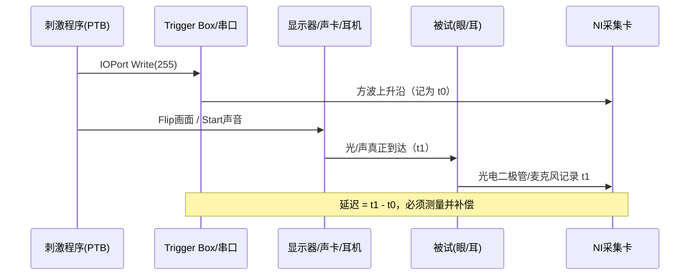
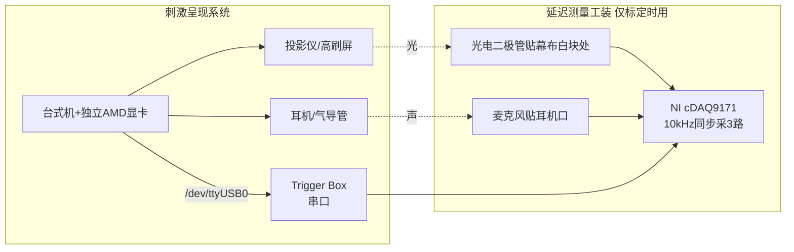
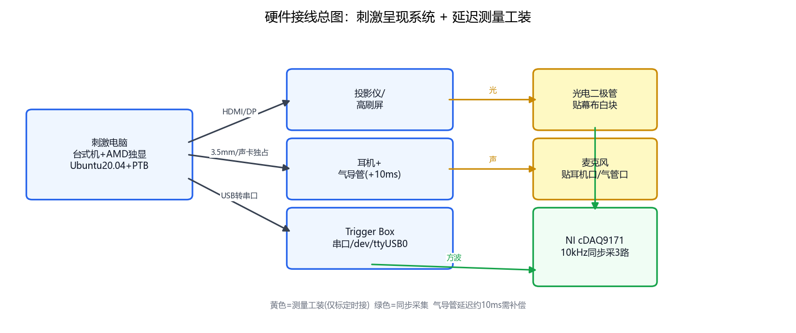
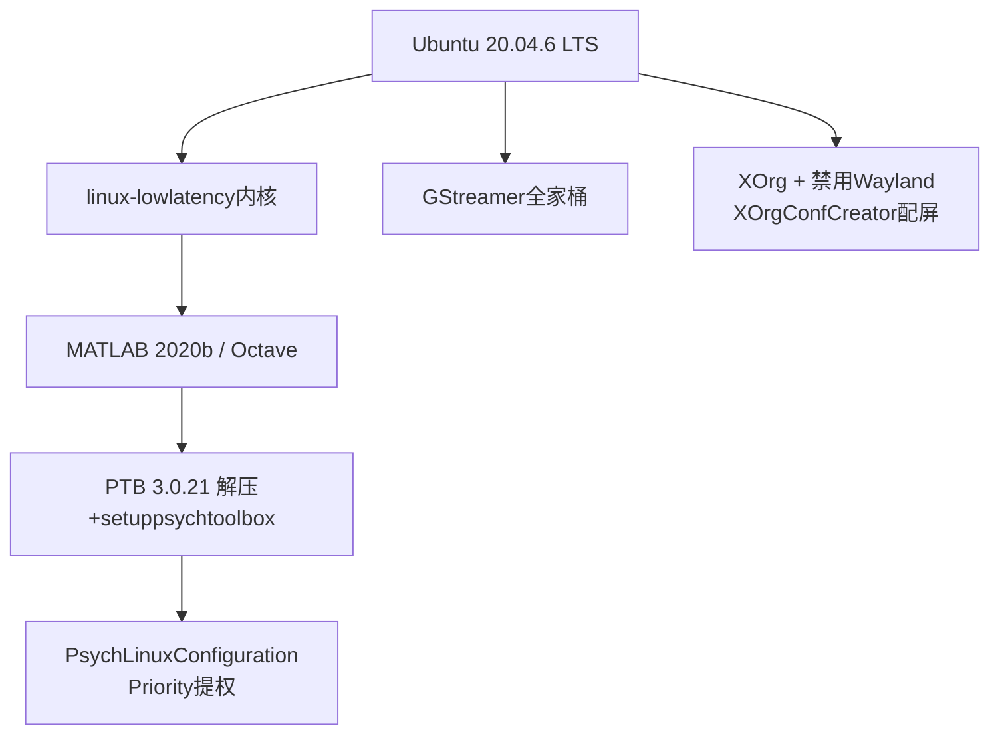
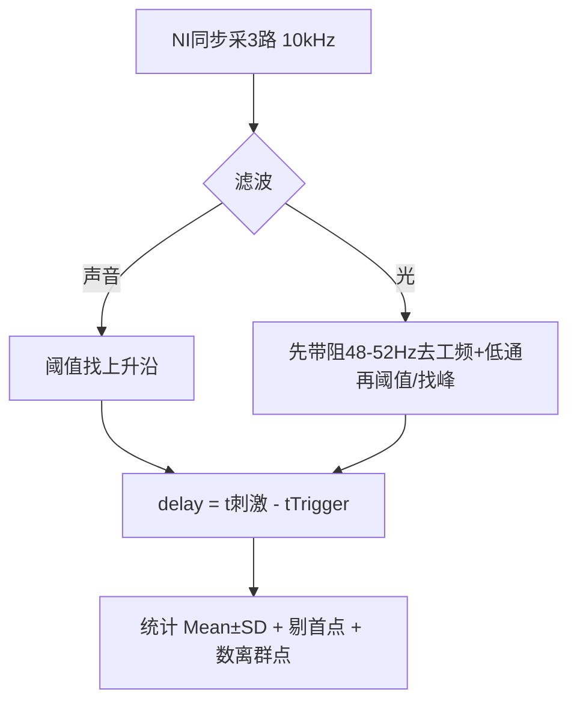
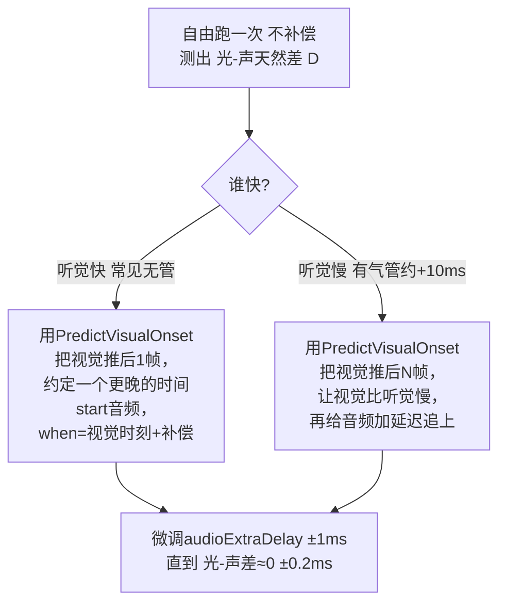
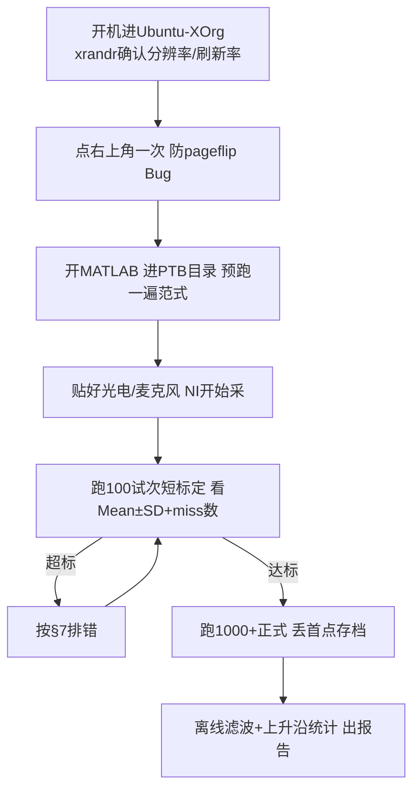

 # 基于 PTB 的高时间精度视听觉刺激呈现软硬件算法说明书

> 面向新手 · 通俗版 · 由本人多设备长期份实验记录提炼
> 目标：让“电脑喊开始 → 被试真正看到/听到”这段时间**又短、又稳**，且视听能对齐。

---

## 0. 一句话原理（先建立直觉）

脑磁图（MEG）时间精度是毫秒级。我们在呈现刺激**前**向采集系统发一个方波（Trigger），以**上升沿**当“刺激发生了”。

但现实是：




- **延迟（delay）** = 真实到达时刻 − Trigger 上升沿，几十 ms，很正常。
- **抖动（jitter）** = 延迟忽大忽小，才是要命的。叠加平均要求抖动 **<1ms**，视听对齐要求 **<0.5ms**。
- 本说明书所有优化，都是为了把抖动压到 1ms 内，同时把绝对延迟做小、做可补偿。

典型成绩单（实测）：


| 条件 | 视觉延迟 | 听觉延迟 | 视听差 | 结论 |
|---|---|---|---|---|
| 刚起步（Win+默认参数） | 47ms ±1ms | 49ms ±20ms | — | 听觉完全不可用 |
| 优化后 60Hz（Ubuntu+AMD）  AMD) | 44–69 ms ±0.1–0.4 ms | 29.2ms ±0.1ms | ±0.2ms | 达标，可做实验 |
| 144Hz 高刷 | ~19→12→8ms ±0.2ms | ~21ms ±0.1ms | ±0.1ms | 越快越小 |
| 240Hz（AOC屏幕/Optoma投影） | ~5.6ms ±0.05ms | — | — | 满速黑白闪烁极限 |


这里的延迟其实是屏幕刷新的间隔，因为是先发送的trigger后flip图像。如果是先flip再发送trigger延迟就应该不随刷新率变化，详细原因见下文。


## 1. 硬件清单：买什么、怎么接

### 1.1 两套系统别搞混





**实拍**——左：麦克风固定在耳机/气导管口录声音；右：光电二极管固定在幕布白色方块区录光强。两路与 Trigger 方波一起进 NI cDAQ9171（10kHz 同步采三路）：

| 麦克风安装实拍 | 光电二极管安装实拍 |
|---|---|
|  |  |

> 要点：麦克风头正对耳机出声孔（用气导管时改贴转接盒口）；二极管感光面紧贴幕布/屏幕白块、拿黑胶带遮杂散光；线用胶带固定防抖，抖一下就是一个离群点。

- **刺激电脑**：必须**台式机 + 独立显卡**，优先 **AMD 老卡**（如 RX5700XT，2020 年前上市的卡，为了保证Ubuntu系统的兼容性）。原因：PTB 与开源驱动（amdgpu/mesa）配合最好；Nvidia 闭源驱动、笔记本混合显卡、Intel 核显都会报同步错误。
- **显示**：普通 60Hz 投影能用；要更小延迟就上高刷屏/高刷投影（144/240Hz）。注意三块屏分辨率要一致，否则 PTB 同步性变差。
- **声音**：耳机经**气导管**进屏蔽室会多约 **10ms** 空气管延迟，记得补偿。声卡要被 PTB 独占（详见下文代码）。
- **Trigger**：USB 转串口给 Trigger Box。Ubuntu 下是 `/dev/ttyUSB0`，要把用户加入 `dialout` 组。
- **测量工装**（标定用，不是每次实验都接）：光电二极管 + 麦克风 + NI 采集卡，三路同步记录 `Trigger/Sound/Light`，采样率 10kHz。光传感器带宽约 1.75kHz（下降沿 0.2ms），够用；信噪比低时靠滤波解决（见 §5）。

> 新手坑：笔记本不要拿来跑正式刺激；“屏幕镜像翻转”在高速黑白闪烁下会花屏；杂牌电竞屏会随机闪一下导致延迟离群——换稳定屏（记录中 AOC屏幕、ViewSonic投影仪 稳，某仿制屏/CFORCE 不稳）。

---

## 2. 软件环境：只推荐一套“省心组合”



- **系统锁定 Ubuntu 20.04**：22.04 之后逐渐弃 XOrg 转 Wayland，PTB 没有继续跟进（2年前我的调研结果，也许已经在开发中），Bug 多（24.04 有名的“点一下右上角才恢复 pageflipping” Bug，25.04 默认驱动双屏正常但 PTB 同步仍可能错）。20.04 + 原生开源驱动是最稳的。
- **关键开关**：
  - BIOS 关 Secure Boot；`/etc/gdm3/custom.conf` 里 `WaylandEnable=false`；不要 `sudo matlab`，直接 `matlab` 启动。
  - `sudo apt install linux-lowlatency`。
  - GStreamer 按官网装全（视频刺激必需）。
  - PTB 不要 `apt` 在线装（太慢），官网下 zip，解压到普通文件夹（别放 MATLAB toolbox 里），进该文件夹跑 `SetupPsychtoolbox`，再跑 `PsychLinuxConfiguration`。
- **显卡驱动**：AMD 卡用系统自带开源驱动即可，不要折腾官方闭源驱动；若执意用 Nvidia，记得 `blacklist nouveau` + 关 gdm3 进 tty 装 `.run`，但同步性依然大概率不如 AMD。

---

## 3. 显示配置：Single vs Multi，一次讲清

| 模式 | 做法 | 优点 | 缺点 |
|---|---|---|---|
| Single Screen | `XOrgConfCreator` 生成单屏配置，投影+显示器合成一个大屏，`Screen('OpenWindow',0)` 占满 | 同步性最好，刷新率精准 | 所有屏分辨率必须一致；作图 X 坐标要偏移半个屏；刷新率被最低的那块拖累 |
| Multi X-Screen | 每个口独立 Screen，`Screen 0/1/2` 分开呈现 | 各屏可不同刷新率（如主 60 + 刺激 144） | 时间精度略差，需调 `ScreenToHead` 指定同步参考屏 |

```matlab
% 单屏独占 + 指定同步源
Screen('Preference','ScreenToHead',0,1,3,0);%（第2、3个数字靠试）
Screen('Preference','SkipSyncTests',0);   % 0=做同步检查，能过才算配好
[window, rect] = Screen('OpenWindow', 0, black);  % 占满，其它 GUI 会被盖住
HideCursor;  % 必须放在 OpenWindow 之后
```

- 配屏工具链：默认无 Conf 时先在桌面 Display 里设好分辨率/刷新率 → MATLAB 里 `XOrgConfCreator` 生成 → `XOrgConfSelector` 选择；搞崩了直接删 `/etc/X11/xorg.conf.d/` 下新 Conf 重启即可。
- 多屏看不到扩展屏分辨率？用 `xrandr --screen 2` 指定屏号看；改刷新率示例：`xrandr --screen 2 --output HDMI-2 --mode 2560x1440 --rate 144`。
- `SkipSyncTests=0` 能过、无 `Synchronization Failure/Trouble`、无 `didn't use pageflipping`，才算配好。24.04 下若报 pageflip，先点一下桌面右上角通知栏再重跑（官方确认的 GNOME Bug）。

---

## 4. 核心算法：PTB 正确使用 7 条（背下来）

> 这是 我用上千次实测换来的结论，违反任何一条都可能导致Jitter回到 ±5ms 甚至 ±50ms。

1. **台式机 + 独立 AMD 显卡 + Ubuntu + MATLAB/Octave**，放弃 Nvidia 闭源、放弃笔记本核显、放弃 Windows 跑正式实验（Windows 最好也就 2ms 波动，且 SyncTest 玄学）。
2. **独占声卡、Buffer 最小**：`handle=PsychPortAudio('Open',[],1,3,sf,2,1)`。`3` 是 latencyclass（最低延迟独占模式），BufferSize 填 `1`（会自动取最小如 14）。 latencyclass选`1/2/4` 都试过：只有 `3` 能把波动压到 1ms 内；`1` 会出现双簇延迟（差 10ms，恰为声卡 High Latency）。
3. **单屏独占显卡，分辨率、新率调一致**（详见 §3），作图注意 X 偏移。

4. **音频播放须定时，图像播放须定帧**：PTB的时间精度很高，但是你也得学会控制；如果你不告诉它确切的执行时间点，它就会变得飘忽不定。音频信号将数据加载进缓存就可以播放，因此只需要选定一个**未来的（很关键）**足够晚（保证数据已经加载进缓存）的时间点开始播放，即`PsychPortAudio('Start', pahandle, 1, tonset+delay, waitForStart=0);`tonset是预先选定的时间锚点，delay就是确保音频能开始播放的等待时长。如果只有音频信号，没有图像，下面提供两种时间锚点的设计思路：
    ```matlab
    PsychPortAudio('FillBuffer', pahandle, [myBeep; myBeep]);%加载音频进缓存
    [nwritten, tonset]=IOPort(‘Write’,handle,uint8(255));%下发triger同时建立时间锚点
	PsychPortAudio(‘Start’,handle,1,tonset+0.015,waitForStart=0);%trigger下发15ms之后开始播放声音，保证音频加载完成且指定精确播放时间，由此稳住trigger和音频之间的延迟。
    ```

    另一种时间锚点思路：
    ```matlab
    PsychPortAudio('FillBuffer', pahandle, [myBeep; myBeep]);%加载音频进缓存
    tonset=GetSecs;%获取当前时间
    PsychPortAudio(‘Start’,handle,1,tonset+0.015,waitForStart=1);
    IOPort(‘Write’,handle,uint8(255));
    ```
    
    注意‘waitForStart=1’，这会使得PsychPortAudio(‘Start’)语句持续占用线程，直到音频播放，此时紧跟着下发trigger，则triger和音频之间的延迟应当接近于0。但是我并不推荐任何这种占用线程的写法，它很容易让整个范式出现bug，我仍然推荐第一种。

    图像的呈现比较复杂，可以想象一个节拍器，哒-哒-哒-哒，图像只能在“哒”的那一下进行切换，也就是`Screen('Flip)`中的Flip。因此，要建立图像呈现的时间锚点，仅仅获取当前时间是不够的，还要获取当前“节拍器”的状态。所幸PTB中有这样一个函数`PredictVisualOnsetForTime`。下面展示图像呈现的时间锚点构建思路，一旦引入图像呈现，音频的呈现也必须以图像的时间锚点为基准（因为后者约束更严格）：
    （核心公式）：
    ```matlab
    t1=GetSecs;
    tonset=PredictVisualOnsetForTime(window,t1); %获取下一帧播放的时间
    PsychPortAudio('Start',pahandle1,1,tonset+delay,waitForStart=0); % 指定时间播放音频
    onset = Screen('Flip',window,tonset+(n+0.5)*ifi);   %指定图像呈现的帧
    [nwritten, when]=IOPort('Write',handle,uint8(255));
    ```
    `(n+0.5)*ifi`中ifi是一帧时长，比如60Hz屏幕就对应16.67ms的ifi，n是一个整数，n+0.5能保证图像在接下来的第(n+1)帧呈现。一旦涉及图像呈现，我建议trigger都在呈现图像后下发，这样可以彻底避免图像呈现跳帧导致的trigger与图像呈现之间的延迟不稳定。
    
    这个示例中音频和图像采用了同一时间锚点tonset，因此能实现同步。


5. **预热**：正式实验前先跑一遍代码（把 mex 都加载了），且**不要换文件夹**再开始。
6. **按键精度**：`KbWait` 约 5ms 轮询粒度；要准就循环 `KbCheck` 并看 `deltaSec` 估精度；更严谨就把按键电信号也进 NI/脑磁同步采集。
7. **视频刺激预先加载**：每试次先 `PlayMovie` 预解码，再 `GetMovieImage(...,1,[],2)` 阻塞取帧，首帧先画进后台缓冲再排程；后续帧用 `onset+ifi*(holdFrames-0.5)` 排（减 0.5 落在刷新中点防跨帧）；详见示例范式/examples/Video_Sound_Sync.


---

## 5. 延迟测量与验证：你也要会标定



- **采什么**：`visual_N.txt / audio_N.txt / visual_audio_N.txt`，三列 Trigger/Sound/Light。
- **怎么判上升沿**：声音直接阈值；光信号先 `[48,52]Hz 带阻 + 60/70/80Hz 低通`（二阶巴特沃斯），再阈值/峰值。记录中仅换判断方法就能把方差从 0.49ms 压到 0.2ms——方差大先别怪 PTB，先优化判断。
- **看什么指标**：
  - `Mean±SD`（如 `44.805±0.165ms`）、`Gaps`（Trigger 间隔，如 60Hz 应为 `33.36±0.07ms`，144Hz 应为 `13.89±0.08ms`，240Hz 应为 `8.34±0.05ms`）。
  - 离群点占比（如 `35/1309=2.67%`）、PTB 的 `missed deadline x/y` 是否与离群数对上。
  - 标准 5 步验证：①满速 Flip 测刷新率+Trigger 稳定 → ②随机间隔+Flip 定时测视觉 → ③随机间隔+Audio 定时测听觉 → ④三者+按键负载测同步 → ⑤长时（1000~8000 次）复测。
- **首次大波动是正常的**：头 5~10 个点偏大，统计时声明“丢首点”。

---

## 6. 视听同步：把光和声对到 0.5ms 内

难点：视觉只能按帧量化（60Hz=16.67ms 一档），听觉可任意预约；且气导管让听觉比视觉**慢**时最难办。



实战代码（高刷/气管版）：

```matlab
t1 = GetSecs;   % 仅试次外/锚点处用一次，不在循环高频调用
tonset = PredictVisualOnsetForTime(window, t1);
audioWhen = tonset + p.audioExtraDelay;  
PsychPortAudio('Start', pahandle, 1, audioWhen, 0);
visualOnset = Screen('Flip', window, tonset + ifi*5.5);% +5.5帧保底视觉更晚
[nwritten, triggerWhen] = IOPort('Write', portHandle, uint8(stimN));
```

- `ifi*5.5` 的 `0.5` 是防“卡在刷新边界多出一帧”；`audioExtraDelay` 每次 ±1~2ms 试，目标 `声-光 ≈ 0±0.2ms`（记录最好成绩 `-0.02±0.08ms`）。
- 若 144Hz 下怎么调都差约 8ms（一帧），说明音频等待超出了 Flip 定时窗口——换 60Hz（帧宽 16.67ms，容差大）立刻好调。这就是“高刷延迟小但同步难，60Hz 同步易”的权衡。
- 同步后必须长时复测：视觉波动峰峰 <1ms、听觉 ±0.1ms、视听差峰峰 <1ms 才算过。

下面是一次调完后的实测。单次记录里，光上升沿和声上升沿叠在一起，都在 Trigger 之后约 11 ms；声音是一段约 50 ms 的纯音，光信号爬升较慢，但判出来的沿和声沿重合：


把每次的声减光画出来，负值表示声略早。约 260 次都落在 0.1 ms 一格上（10 kHz 采样），主体在 −0.6 到 −0.3 ms，个别点到 −0.1 ms，极差约 0.5 ms：


---

## 7. 新手排错表（先查表，别重装）

| 现象 | 最可能原因 | 解法 |
|---|---|---|
| `Synchronization Failure / Trouble`，`missed deadline` 大片 | 显卡/驱动/双屏 wiring 不对；用了 Nvidia 闭源/核显/笔记本 | 换 AMD 独显；重跑 `XOrgConfCreator/Selector`；试 `ScreenToHead` 第 2~4 参数；单屏模式；重启 MATLAB；24.04 点右上角通知栏 |
| `didn't use pageflipping` | GNOME 合成器没让出全屏 | 点右上角+通知栏一次；换 KDE；退回 20.04；禁用 Wayland |
| 延迟双簇（如差 10ms 两团） | `latencyclass≠3` / Buffer 太大 / 声卡被占用 | `Open(...,3,...,1)` + 独占 + Buffer=1；关其它声音软件；电源性能拉满 |
| 头几个点超大、后半段突变密/疏 | MATLAB 预热 + 首帧惩罚 + 改分辨率没重启 | 预跑一遍、丢首点、改显示设置后重启 MATLAB/电脑 |
| 加了 `WaitSecs` 就抖 | 与 `Flip` 抢线程（铁律） | 全换成 `Flip(when)` 定时；`KbCheck` 保留，`GetSecs/now` 移出循环 |
| 视听差恒定一帧（16.6/6.9/8.3ms） | Flip 后发 vs 前发口径 / 音频补偿超窗 | 统一口径；按 §6 重调 `audioExtraDelay` 或帧数；必要时降到 60Hz 调 |
| 投影延迟 127ms±8ms、满速上不去 | 老机器 + Nvidia + 高刷要不起 | 换 AMD 老卡+20.04；投影最高 60Hz 就按 60Hz 标定；高刷上 AOC/ViewSonic/Optoma 240Hz 实测稳 |
| `libGL fail to open nouveau/swrast` | 驱动软链丢了 | `ln -s /usr/lib/x86_64-linux-gnu/dri/nouveau_dri.so /usr/lib/dri/` 及 MATLAB 的 `libstdc++.so.6` 软链 |
| 串口找不到 | 没进 `dialout` 组 | `ls /dev/ttyUSB*` + `dmesg\|grep ttyUSB` 定位，`usermod -aG dialout 用户名` 后重启 |

---

## 8. 开机到实验：标准操作流



每次换屏/换线/换刷新率/换电脑，都重走一遍。测量文件名建议 `visual/audio/visual_audio_序号.txt` + `gaps_序号.txt`（PTB 回读 `when/onset`），方便回溯。

---

## 附录 A. 参数速查卡

- 声卡：`PsychPortAudio('Open',[],1,3,sf,2,1)`，`FillBuffer` 在 Trigger 前做完，`Start(...,when+0.015,0)`（`waitForStart=0` 才能排程不等死）。
- 视觉：`Flip(window, when+0.015)`，控时长用 `Flip(window, onset+ifi*(hold-0.5))`。
- 同步：`PredictVisualOnsetForTime` + `ifi*5.5` + `audioExtraDelay` 微调。
- 统计：丢首点，目标 视觉±0.4ms / 听觉±0.1ms / 视听±0.25ms；240Hz 满速可到 ±0.05ms。
- 气管 +10ms、60Hz 一帧 16.67ms、144Hz 一帧 6.94ms、240Hz 一帧 4.17ms——补偿时心里要有这把尺。

> 一句话收尾：**好硬件（AMD+Ubuntu20.04）× 对的代码（定时定帧）× 勤标定（NI 三路 + 滤波 + 长时复测）= 高时间精度。** 祝首跑即稳。
